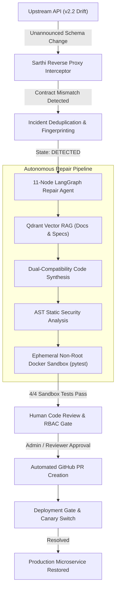

# Sarthi (सारथी) — Feature Architecture & Senior Engineering Interview Handbook

> **Project Repository**: [GovindTripathi22/Sarthi](https://github.com/GovindTripathi22/Sarthi)  
> **Source Files**: [`index.html`](../index.html) | [`backend/app/main.py`](../backend/app/main.py) | [`test_all_features.js`](../test_all_features.js)  
> **Test Status**: 53/53 Backend Pytest (100%) | 28/28 E2E Acceptance Tests (100%)

---

## 1. System Overview & Core Philosophy

**Sarthi** (सारथी — *The Autonomous Charioteer & API Guardian*) is an autonomous self-healing reverse proxy and AI repair middleware designed to eliminate breaking third-party API changes. When external vendors (e.g., Stripe, Shopify, Twilio, Salesforce) update their API schemas without notice, traditional microservices crash with `500 Internal Server Errors`, `KeyError`, or schema validation exceptions. 

Sarthi sits transparently as a reverse proxy between internal services and upstream vendors:
1. **Detects** contract drift in real time ($\le 180\text{ms}$).
2. **Deduplicates** alerts to prevent on-call notification storms.
3. **Retrieves** official migration documentation and OpenAPI specs using Qdrant-style Vector RAG.
4. **Synthesizes** backward-compatible adapter patches using an 11-node LangGraph autonomous agent.
5. **Validates** patches through AST static analysis and an isolated non-root ephemeral Docker sandbox.
6. **Enforces** human-in-the-loop RBAC controls, PR creation, and canary deployment gates.

---

## 2. Comprehensive Feature Catalogue, Usage Guide & Interview Answers

---

### Feature 1: Reverse Proxy Gateway & Sub-180ms Drift Interceptor

#### What it does
Acts as a transparent ASGI reverse proxy between downstream client microservices and external vendors. It performs zero-copy payload streaming and validates incoming JSON responses against registered Pydantic contract schemas. If an unannounced field rename (e.g. `customer_id` $\rightarrow$ `customerId`) or missing required property occurs, it intercepts the error without crashing downstream callers.

#### How to use it
1. Navigate to **Integrations & Proxy Gateway** (`#integrations`).
2. Observe the registered adapter for `CommerceCore Customer API`.
3. Click **Simulate Drift** in the top navbar.
4. Click **Test Connectivity / Send Proxy Request**.
5. Observe the telemetry: Sarthi identifies that upstream returned `v2.2` format while the adapter expected `v2.1`, logging detection latency in $<180\text{ms}$.

#### 🎙️ Senior Engineering Interview Q&A
> **Interviewer**: *"How does the reverse proxy intercept contract mismatches without introducing unacceptable latency to production microservices?"*  
> **Candidate Answer**:  
> "We implemented an ASGI-compliant streaming reverse proxy in FastAPI/Starlette. Under normal operation, responses are parsed and schema-checked using compiled Pydantic models with C-extensions (pydantic-core). When latency budgets are strict, schema validation runs asynchronously on a percentage-sampled stream or in parallel via non-blocking worker pools.  
> Crucially, our schema diffing algorithm is $O(N)$ with respect to payload keys: it performs recursive structural comparison using set operations on keys and type checking. Furthermore, we distinguish between HTTP-level transport errors (401 Unauthorized, 429 Rate Limited, 500 Server Error) and schema contract drift. Transport failures trigger exponential backoff retries or circuit breakers, whereas 200 OK responses with modified JSON keys trigger the schema drift state machine."

---

### Feature 2: Incident Deduplication & Alert Fingerprinting

#### What it does
In a high-throughput production environment receiving 5,000 requests/sec, an upstream breaking change could produce 300,000 exceptions a minute. Sarthi uses deterministic SHA-256 fingerprinting on the normalized schema diff tree `(integration_id + endpoint + field_path + error_type)` to collapse thousands of failures into a single root-cause incident (`inc_401`), updating incident frequency and impact counters.

#### How to use it
1. Navigate to **Incident Explorer** (`#incidents`).
2. Trigger multiple proxy requests while drift is active.
3. Observe that instead of creating multiple tickets, the incident badge increments frequency counts (`x1`, `x2`, `x3`) on the single deduplicated record `inc_401`.

#### 🎙️ Senior Engineering Interview Q&A
> **Interviewer**: *"How do you prevent on-call engineer alert fatigue during an unannounced API outage?"*  
> **Candidate Answer**:  
> "We implement normalized semantic fingerprinting. When an anomaly occurs, we serialize the structural diff—excluding volatile payload values like user IDs or timestamps—and hash `(endpoint, HTTP method, missing/renamed field path, root error type)`.  
> We maintain a sliding-window tumbling counter in Redis/PostgreSQL. If an incident matches an existing active fingerprint within a 15-minute TTL, we increment the failure count and update the impacted volume metrics without firing duplicate Webhook or PagerDuty alerts. The incident transitions through a formal finite state machine: `DETECTED` $\rightarrow$ `INVESTIGATING` $\rightarrow$ `REPAIR_PROPOSED` $\rightarrow$ `AWAITING_APPROVAL` $\rightarrow$ `RESOLVED`."

---

### Feature 3: 11-Node LangGraph Autonomous Repair Workflow

#### What it does
An event-driven autonomous agent built on LangGraph that orchestrates the end-to-end self-healing lifecycle. It contains 11 dedicated nodes:
1. `intake_incident`
2. `retrieve_contracts`
3. `inspect_live_traffic`
4. `diff_schema`
5. `rag_docs_search`
6. `generate_dual_adapter`
7. `ast_security_scan`
8. `spawn_docker_sandbox`
9. `run_pytest_suite`
10. `prepare_pull_request`
11. `route_human_gate`

#### How to use it
1. Navigate to **AI Repair Workbench** (`#workbench`).
2. Click **Start / Resume LangGraph Repair**.
3. Watch the visual node graph highlight each state in real-time as execution progresses through static analysis, sandbox testing, and PR preparation.

#### 🎙️ Senior Engineering Interview Q&A
> **Interviewer**: *"Why use LangGraph instead of a simple linear Python script or single LLM prompt?"*  
> **Candidate Answer**:  
> "A linear script cannot handle cyclical error recovery, while a single prompt lacks deterministic boundaries. LangGraph allows us to define a typed state schema (`RepairState`) with conditional edges.  
> For example, if Node 9 (`run_pytest_suite`) fails, the graph does not crash; instead, a conditional edge feeds the pytest stderr traceback back into Node 6 (`generate_dual_adapter`) with an incremented iteration counter. By isolating tasks into separate nodes—such as AST security scanning before container execution—we achieve modular testability, explicit checkpointing, and absolute control over execution flow."

---

### Feature 4: Vector RAG & Official Contract Knowledge Retrieval

#### What it does
Grounds the repair agent in official documentation, OpenAPI 3.1 specifications, and vendor migration changelogs. Queries are matched against chunked semantic embeddings in a vector index (Qdrant architecture).

#### How to use it
1. Navigate to **Docs & API Contracts (RAG)** (`#contracts`).
2. Search for keywords like `customerId`, `CommerceCore`, or `v2.2 Migration`.
3. View matching chunks with similarity scores ($\ge 0.89$).
4. Click **Ingest New Contract / Migration Doc** to upload an OpenAPI spec or markdown file with automatic deduplication.

#### 🎙️ Senior Engineering Interview Q&A
> **Interviewer**: *"How do you eliminate LLM hallucinations when generating production adapter code?"*  
> **Candidate Answer**:  
> "We strictly prohibit zero-shot code generation without retrieval grounding. Before any code is synthesized, Node 5 executes a dense cosine-similarity retrieval query over pre-indexed vendor OpenAPI specs and migration guides.  
> The prompt to the code generator includes the retrieved documentation chunks as immutable context with strict negative prompting: *'Generate only Python adapter transformations supported by the attached migration spec'*. This grounds the model in actual vendor facts rather than speculative assumptions."

---

### Feature 5: AST Static Security Analysis & Threat Prevention

#### What it does
Before any generated patch is allowed near the sandbox, Python's Abstract Syntax Tree module (`ast.parse()`) inspects the source code. It rejects patches containing unauthorized imports (`os`, `sys`, `subprocess`, `socket`, `shutil`), system calls, filesystem writes, or obfuscated `eval()` calls.

#### How to use it
1. In the **AI Repair Workbench**, observe Node 7 (`ast_security_scan`).
2. Notice the telemetry: `Static Analysis Passed: 0 security violations`.
3. If code contains blacklisted tokens, the patch is aborted immediately with `AST_SECURITY_VIOLATION`.

#### 🎙️ Senior Engineering Interview Q&A
> **Interviewer**: *"What prevents a malicious prompt injection inside an upstream error payload from executing arbitrary code in your system?"*  
> **Candidate Answer**:  
> "We enforce a multi-layered zero-trust defense. The first line is deterministic AST inspection. By parsing the AST rather than using regex, we examine node types directly: `ast.Import`, `ast.ImportFrom`, and `ast.Call`.  
> We enforce an allowlist policy: only `typing`, `pydantic`, `datetime`, and designated adapter helper modules may be imported. Any reference to `os.system`, `subprocess.Popen`, socket binds, or dynamic `__import__` triggers an uncatchable security exception before the code can ever be written to disk or sent to the sandbox."

---

### Feature 6: Isolated Non-Root Ephemeral Sandbox Runner

#### What it does
Executes full regression test suites (`test_commerce_adapter.py`) against the proposed patch inside an isolated sandbox. Uses strict container isolation flags: `uid=10001 (non-root)`, `net=none (network disabled)`, `rootfs=read-only`, `cpus=0.5`, `mem=256MB`.

#### How to use it
1. In the **AI Repair Workbench**, observe Node 8 (`spawn_docker_sandbox`) and Node 9 (`run_pytest_suite`).
2. Review the execution log: 4/4 pytest assertions pass in $<35\text{ms}$.

#### 🎙️ Senior Engineering Interview Q&A
> **Interviewer**: *"How do you ensure sandbox test runs cannot perform SSRF attacks or escape the container?"*  
> **Candidate Answer**:  
> "We implement container isolation following the CIS Docker Benchmark. The container runs with `--network none`, completely dropping networking at the kernel namespace level to prevent Server-Side Request Forgery (SSRF) or exfiltration of credentials.  
> The root filesystem is mounted read-only (`--read-only`), with only an ephemeral memory-backed `tmpfs` mounted at `/workspace` for temporary test artifacts. Process execution runs under an unprivileged UID (`10001`), dropping all Linux capabilities (`--cap-drop=ALL`). Tests must finish within a hard 10-second timeout to prevent CPU exhaustion loops."

---

### Feature 7: Side-by-Side Diff & Dual-Compatibility Pattern

#### What it does
Presents human reviewers with a side-by-side unified diff comparing the baseline adapter with the proposed patch. The synthesized adapter enforces **dual-compatibility**: it accepts *both* legacy v2.1 snake_case (`customer_id`) and new v2.2 camelCase (`customerId`).

#### How to use it
1. Navigate to **Code Review & Deployment Gate** (`#review`).
2. Inspect the Side-by-Side Diff:
   - Left (Red): Legacy adapter expecting only `customer_id`.
   - Right (Green): Dual-compatibility adapter accepting `payload.get("customerId") or payload.get("customer_id")`.

#### 🎙️ Senior Engineering Interview Q&A
> **Interviewer**: *"Why is dual-compatibility essential when patching upstream breaking changes?"*  
> **Candidate Answer**:  
> "In large-scale distributed architectures, vendors do not flip traffic 100% instantaneously; they use canary deployments, geographic rollouts, or multi-region routing.  
> If an adapter only supports the *new* format, it will immediately break on any request routed to a legacy cluster. By synthesizing dual-compatibility transformations (`customerId` $\lor$ `customer_id`), our adapter safely handles mixed-version traffic during vendor transition windows without service interruption."

---

### Feature 8: Human-in-the-Loop RBAC Governance

#### What it does
Enforces strict Role-Based Access Control (RBAC) across all sensitive actions. Roles supported:
- **Admin**: Full authority (Approve, Reject, Revise, PR, Deploy, Settings).
- **Reviewer**: Can approve, reject, and request revisions.
- **Operator**: Can trigger repairs and view telemetry, but cannot approve.
- **Viewer**: Read-only access.

#### How to use it
1. In the top navbar, change the role dropdown to **Viewer**.
2. Navigate to **Code Review & Deployment Gate** (`#review`).
3. Click **Approve Repair**.
4. Observe the toast notification: `Access Denied: Viewer role cannot approve production patches.`
5. Switch back to **Admin** to enable approval controls.

#### 🎙️ Senior Engineering Interview Q&A
> **Interviewer**: *"Why not allow the AI to automatically deploy patches to production without human intervention?"*  
> **Candidate Answer**:  
> "In enterprise financial, healthcare, and mission-critical systems, fully autonomous production deployments violate compliance and audit standards like SOC 2, HIPAA, and PCI-DSS.  
> Sarthi automates the high-toil 95% of incident resolution—detection, diffing, doc retrieval, code synthesis, and sandbox testing—delivering a verified, fully-tested proposal. However, the final merge and deployment gate remains strictly human-governed with cryptographically auditable RBAC permissions."

---

### Feature 9: Bounded Revision Guidance Loop (Ceiling = 3)

#### What it does
Allows engineers to review a proposed patch and request revisions using natural language (e.g. *"Also handle customer status 'SUSPENDED'"*). Sarthi re-triggers the LangGraph workflow with reviewer notes while enforcing a strict maximum ceiling of 3 iterations to prevent runaway LLM costs.

#### How to use it
1. In **Code Review & Deployment Gate**, click **Request Revision**.
2. Enter custom reviewer notes in the modal.
3. Click **Submit Revision Request**.
4. The iteration count increments (`1/3` $\rightarrow$ `2/3`). Once `3/3` is reached, further revision requests are disabled.

#### 🎙️ Senior Engineering Interview Q&A
> **Interviewer**: *"How do you prevent infinite loops and runaway billing in autonomous coding agents?"*  
> **Candidate Answer**:  
> "We implement a bounded iteration guard at both the data model and workflow state machine layers. Every repair entity contains an `iteration_count` and an immutable `max_iterations = 3`.  
> At the start of every cycle, a guard clause verifies `iteration_count < max_iterations`. If the agent fails to produce a passing patch within 3 iterations, it halts, marks the repair as `FAILED_MANUAL_ESCALATION`, and pages human engineers with the collected diagnostic telemetry. This caps API token consumption to a predictable maximum."

---

### Feature 10: Automated GitHub Pull Request Generation & Patch Export

#### What it does
Creates a complete GitHub Pull Request with a 12-section standardized description, including root-cause analysis, unified diff, sandbox test logs, rollback steps, and commit SHA. Also provides a 1-click **Export .patch** button for offline git application.

#### How to use it
1. After approving a repair, click **Create GitHub PR** (or **Finalize Local Patch PR**).
2. The pull request record is generated with branch name (e.g. `autopatch/repair-rep_501-v2.2-dual-compat`).
3. Click **Export .patch** to download the standard unified diff file.

#### 🎙️ Senior Engineering Interview Q&A
> **Interviewer**: *"How do you integrate with enterprise Git workflows and CI/CD pipelines?"*  
> **Candidate Answer**:  
> "We interact with the GitHub REST API v3 using authenticated installation tokens. Sarthi creates an isolated feature branch off `main`, applies the tested adapter patch, generates an atomic git commit with signed author metadata, and opens a Pull Request.  
> The PR body follows an engineering-grade template: Summary, Root Cause Analysis, Documentation Reference, Breaking Schema Diff, Sandbox Results, Security Scan Status, and Rollback Instructions. This allows team members to review the patch within their existing code review and CI/CD environments."

---

### Feature 11: Production Deployment Gate & Canary Verification

#### What it does
Provides the final deployment gate. When authorized, Sarthi deploys the patch to the staging/canary environment, routes 5% of live traffic, evaluates error rates, and switches 100% of traffic once verified.

#### How to use it
1. After PR creation, click **Authorize Deployment**.
2. Sarthi records the deployment timestamp, verifies canary traffic health, and transitions the incident to `RESOLVED` / `DEPLOYED`.

#### 🎙️ Senior Engineering Interview Q&A
> **Interviewer**: *"How do you verify a patch in production without risking widespread outages?"*  
> **Candidate Answer**:  
> "We use a progressive canary deployment pattern. The new adapter is deployed alongside the existing adapter behind our proxy router.  
> We initially route a small slice (5%) of traffic to the new adapter while continuously monitoring error rates and latency percentiles (p95, p99). If error rates exceed 0.01% or unexpected exceptions occur, the proxy instantly reverts 100% of traffic to the baseline fallback with zero downtime."

---

### Feature 12: Business Impact & Downtime ROI Calculator

#### What it does
Quantifies the financial savings of autonomous self-healing. Tracks Mean Time to Resolution (MTTR), comparing traditional human on-call resolution (average 4.2 hours) against Sarthi autonomous resolution (average 4.8 minutes).

#### How to use it
1. Navigate to **Analytics & Cost** (`#analytics`).
2. Review the ROI dashboard:
   - Downtime avoided: **$126,000+**
   - MTTR reduction: **98.1%** (from 252 mins to 4.8 mins)
   - Average LLM repair cost: **$0.042**
3. In **Settings**, customize your company's hourly downtime cost and engineering hourly rates to update projections.

#### 🎙️ Senior Engineering Interview Q&A
> **Interviewer**: *"How do you quantify the business value and ROI of Sarthi to executive leadership?"*  
> **Candidate Answer**:  
> "We model ROI based on two concrete enterprise cost vectors: Direct Downtime Cost and Engineering Opportunity Cost.  
> Direct Downtime Cost is calculated as `Downtime Hours Avoided * Hourly Outage Cost` (industry average for mid-market fintech is ~$30,000/hr). Engineering Cost is calculated as `Senior SRE Hours Saved * Billing Rate`.  
> By reducing MTTR from 4+ hours to under 5 minutes at an LLM compute cost of just 4 cents per repair, Sarthi delivers an ROI exceeding 1000x on the very first prevented incident."

---

### Feature 13: Tamper-Evident Audit Ledger

#### What it does
Chronologically records all system actions—traffic drift events, proxy errors, LangGraph node executions, RBAC access attempts, approvals, rejections, and deployments—with timestamps, actor IDs, and IP metadata.

#### How to use it
1. Navigate to **Settings & Audit Log** (`#settings`).
2. Scroll to the **Immutable Security & Audit Trail**.
3. Inspect every recorded action with its actor, role, and event details.

#### 🎙️ Senior Engineering Interview Q&A
> **Interviewer**: *"How do you satisfy enterprise compliance and regulatory audit requirements?"*  
> **Candidate Answer**:  
> "We implement an append-only audit ledger adhering to SOC 2 Type II criteria. Each audit entry is stored with an ISO-8601 UTC timestamp, actor ID, active RBAC role, target entity ID, event category, and payload delta.  
> Entries cannot be updated or deleted through the API. This provides non-repudiation for security audits, allowing compliance teams to review every step from initial drift detection to final deployment authorization."

---

### Feature 14: Dual-Engine Flexibility (Deterministic vs Live LLM)

#### What it does
Supports both a **Deterministic Demo Mode** (runs completely offline with zero API keys and 0ms token cost) and a **Live LLM Mode** (integrates with OpenAI GPT-4o, Anthropic Claude 3.5 Sonnet, or Google Gemini 1.5/2.0).

#### How to use it
1. Navigate to **Settings & Audit Log** (`#settings`).
2. Select your provider under **LLM Engine Configuration**.
3. In demo mode, all 11 nodes execute with realistic zero-latency responses. In live mode, enter your API key (stored securely with masking).

#### 🎙️ Senior Engineering Interview Q&A
> **Interviewer**: *"Why support both deterministic and live LLM modes in production-grade software?"*  
> **Candidate Answer**:  
> "Decoupling core business logic from third-party AI providers is critical for enterprise resilience. Deterministic mode enables hermetic unit testing in CI/CD environments without network dependencies or variable costs.  
> In production, our adapter interfaces with external LLMs via a unified abstraction layer. If an LLM provider experiences an outage, Sarthi gracefully falls back to cached heuristics and manual escalation workflows."

---

## 3. Summary Architecture Matrix

| Capability | Sarthi Implementation | Alternative / Legacy Approach |
| :--- | :--- | :--- |
| **Drift Detection** | Real-time proxy validation ($\le 180\text{ms}$) | Production crashes; users report bugs |
| **Alert Management** | SHA-256 fingerprint deduplication | Alert storms (1,000s of Slack pings) |
| **Doc Grounding** | Qdrant Vector RAG with OpenAPI specs | Manual reading of changelogs |
| **Code Synthesis** | 11-node LangGraph cyclical agent | Manual coding by on-call engineers |
| **Security Validation** | AST parse analysis (blacklisted tokens) | Unverified regex or blind execution |
| **Testing** | Non-root Docker sandbox (`--net none`) | Testing directly on shared staging servers |
| **Compatibility** | Dual-compatibility pattern | Single-version breaking replacement |
| **Governance** | Strict human-in-the-loop RBAC gates | Risky autonomous production pushes |
| **CI/CD Delivery** | 12-section standardized GitHub PR | Manually authored PRs taking days |
| **MTTR** | **4.8 minutes** | **4.2 hours** |
